*This project has been created as part of the 42 curriculum by sbruma, pamatya, mkijewsk, maba.*

# Transcendence

## Description

Our **Transcendence** is a small online arcade with two games: rock-paper-scissors and tic-tac-toe. You sign up, pick a game from the catalog and play against another person in rock-paper-scissors or tic-tac-toe. Every match is saved: it feeds your match history and statistics, earns XP, raises your level, unlocks achievements and moves you up the leaderboard. Friends, live chat and online status tie the players together.

The goal of the project (42's ft_transcendence) is a complete web application built by a team of four: a frontend, a backend and a database, run with one command, with real-time multiplayer at its centre.

**A visit, start to finish:** register with a username, email and password, then log in; the session survives a page reload. The game catalog is the main page, with the leaderboard, your profile and the friends page one click away. On a game page you choose your settings (match length, mode, theme, power-ups) and join the queue, which pairs you with a player on the same settings and a similar level. The match plays live; if your connection drops you have 30 seconds to come back. At the end you see the result, and your history, stats, XP and achievements update. From the leaderboard you open anyone's profile and send a friend request; once accepted you see each other online and can chat.

### Key features
- Two real-time games over WebSockets: rock-paper-scissors (against a person) and tic-tac-toe (person against person)
- Matchmaking by settings and level, with the search widening after 15 seconds
- Reconnection: a dropped player has 30 seconds to rejoin before forfeiting
- Game settings per player: two match modes, target 1–10, two themes, shield and double power-ups
- Match history with opponents, statistics per game, XP, levels, achievements and a leaderboard
- Profiles, friends, live chat and online status, all updated live over WebSockets
- Avatar upload with preview, progress bar and validation in the browser and on the server
- A public API with per-user API keys, rate limiting and Swagger documentation
- HTTPS everywhere, the whole stack started with one command

## Running the Application

The entire stack runs via Docker Compose behind an Nginx reverse proxy providing HTTPS everywhere.

```bash
# Generate certificates (auto-detects local IP/hostname SANs) and start containers
make up
```

- **HTTPS (Port 443):** Single public entry point (`https://localhost` or `https://<LAN_IP>`).
- **HTTP (Port 80):** Automatically redirects all traffic to HTTPS (301 Moved Permanently).
- **Backend API & WebSockets:** Proxied under `/api/` (`https://<host>/api/...` and `wss://<host>/api/...`).
- **Internal Ports:** The frontend container (8080) and backend container (3000) are not exposed directly on the host, ensuring all incoming traffic is encrypted through Nginx.

## Accessing from Another Device on the LAN

During evaluations or multi-device demos:

1. **Find your local IP address:**
   ```bash
   ipconfig getifaddr en0
   ```
   *(e.g., `192.168.0.2`)*

2. **Regenerate certificates (if moving to a new Wi-Fi network):**
   ```bash
   make certs-clean
   make up
   ```
   The [Makefile](Makefile) automatically includes your LAN IP and Bonjour hostname (`<LocalHostName>.local`) in the certificate's Subject Alternative Names (SAN). You can also explicitly specify an IP:
   ```bash
   make up HOST_IP=192.168.0.2
   ```

3. **Open the browser on the second device:**
   - Connect the second device to the same Wi-Fi network.
   - Navigate to `https://<HOST_IP>` (e.g. `https://192.168.0.2`).
   - Accept the self-signed certificate warning.
   - Register/log in. The frontend dynamically sends API requests and opens WebSockets to the host you loaded the page from, and session cookies persist across reloads.


### Playing PvP Across Two Devices on the Same Network

To demo multiplayer gameplay across two computers:

1. **Player 1 (Host Mac):**
   - Navigate to `https://localhost` (or `https://<HOST_IP>`).
   - Log in with Account 1 (e.g. `alice`).
   - Click **"Connect RPS Socket"**.
   - Open DevTools Console (`F12`) and join the matchmaking queue:
     ```javascript
     sendRps('queue');
     ```
     *(Console displays: `waiting for an opponent`)*

2. **Player 2 (Second Computer / Phone):**
   - Connect to the same Wi-Fi.
   - Navigate to `https://<HOST_IP>`.
   - Log in with Account 2 (e.g. `bob`).
   - Click **"Connect RPS Socket"**.
   - Open DevTools Console (`F12`) and join the queue:
     ```javascript
     sendRps('queue');
     ```

3. **Match in Progress:**
   - Both consoles instantly receive a `matched` event with a shared `sessionId` and match settings.
   - Both players submit a move within the 60s round limit:
     - Player 1: `sendRps('move', 'rock');`
     - Player 2: `sendRps('move', 'scissors');`
   - As soon as both moves are in, both consoles receive the `round` event with the outcome and updated scores.
   - Play continues until a player wins the match (best-of-3 by default), ending with an `over` event and persisting the result to PostgreSQL.

## Instructions

### Prerequisites
- Docker with Docker Compose v2 (`docker compose`); version 2.22 or newer for `make dev` (it uses `--watch`)
- `make`
- `openssl` (for `make certs`)
- Google Chrome, latest stable
- Nothing else on the host: Node, PostgreSQL and nginx run in containers

### Configuration
1. `cp .env.example .env`
2. Fill in the values:

| Variable | Required | What it is |
|---|---|---|
| `POSTGRES_NAME` | yes | database name |
| `POSTGRES_USER` | yes | database user |
| `POSTGRES_PASSWORD` | yes | database password |
| `POSTGRES_HOST` | no | leave `localhost`; only used by tools run outside Docker — the backend container always uses `db` |
| `JWT_SECRET` | yes | signs login tokens; at least 32 characters. Generate one with `openssl rand -base64 32` |
| `POSTGRES_PORT` | no | leave `5432`; the backend container always uses 5432 |
| `APP_PORT` | no | the port the backend is published on, on your machine (default `3000`) |

`.env` is ignored by Git and never committed.

### Run
1. `make` — creates the self-signed HTTPS certificates (for nginx and the backend), then builds and starts four containers: `db` (PostgreSQL 17), `backend`, `frontend` and `nginx`
2. Open **https://localhost** in Chrome and accept the self-signed certificate warning once

The database tables are created automatically when the backend starts (migrations run at boot), and each game registers itself.

### Stop / reset
- `make down` — stop everything
- `make clean` — stop and **delete all data**: the database and uploaded avatars (both live in Docker volumes)
- `make fclean` — same as the one above, plus the built images
- `make reset` — `make fclean`, then `make up`: a completely fresh start
- `make help` — show every target description

### Development
- `make dev` — frontend with live reload (Angular dev server, files synced into the container)

### API
- Interactive documentation (Swagger): **https://localhost/api/docs**
- Every route is under `https://localhost/api/...`
- API keys: log in, then `POST /api/users/self/api-keys` with your login token. The key is shown once. Send it as the `X-API-Key` header on the five public routes (below); 60 requests a minute per key.

## Resources

### References
- NestJS — https://docs.nestjs.com
- Angular — https://angular.dev
- Angular Material — https://material.angular.dev
- Drizzle ORM — https://orm.drizzle.team
- PostgreSQL 17 — https://www.postgresql.org/docs/17/
- `ws` (WebSocket library for Node) — https://github.com/websockets/ws
- The WebSocket protocol, RFC 6455 — https://datatracker.ietf.org/doc/html/rfc6455
- JSON Web Tokens — https://jwt.io/introduction
- nginx — https://nginx.org/en/docs/
- Docker Compose — https://docs.docker.com/compose/
- OpenAPI / Swagger — https://swagger.io/specification/

### Use of AI
- **sbruma:** Claude (Anthropic): explaining concepts and libraries; optimizing work flow by keeping track of everyone's tasks; highlighting formatting issues and unobserved team agreements during PR reviews; drafting test cases; drafting this README; AI code generation of HTML+CSS files where the component class and respective services were already implemented.
- **pamatya:** GitHub Copilot (Sonnet, Gemini, GPT Luna) with explaining Typescript and NestJS concepts and libraries. Researching features and planning, as well as for assistance in reviewing PRs from teammates on other parts of the project including stress-testing and researching edge cases. Also used for drafting PR descriptions, drafting Readme for leaving helpful guides for teammates on how to play the game with backend alone, as well as updating markdown representation of the database schema.
- **mkijewsk:** GitHub Copilot (automatic model selection) with [angular-developer](https://github.com/angular/skills/tree/main/angular-developer) and [angular-material-skill](https://github.com/nicolasaigner/angular-material-skill) skills - AI code generation of few component's HTML+CSS files where the component class and respective services were already implemented. Those were later reviewed and adapted by hand to match expected UI state. ChatGPT + Google Chrome's AI Overview - searching.
- **maba:** Claude (Anthropic), through Claude Code: explaining concepts and official docs before each step (NestJS guards and gateways, JWT, Angular signals and effects); planning tickets; reviewing teammates' pull requests (spotting issues, then checking them by running the tests on the branch); drafting PR descriptions; writing explanatory documents with architecture diagrams. I wrote and applied every change myself and checked it with the tests.


## Team Information

Four people, so everyone is also a Developer.

| Member (login) | Role(s) | Responsibilities |
|---|---|---|
| Stefan (sbruma) | Product Owner, Developer | product vision and backlog; deciding features and priorities; validating finished work; presenting the project to evaluators. |
| Pranuj (pamatya) | Project Manager, Developer | organising meetings and planning; tracking progress and deadlines; team communication; risks and blockers. |
| Marian (mkijewsk) | Technical Lead, Developer | technical architecture and stack decisions; code quality and conventions; reviewing critical changes. |
| Cherif (maba) | Developer | authentication and session security (tokens, refresh, logout); real-time layer (WebSocket authentication, online status); friends and chat backend; reviewing pull requests. |


## Project Management

- **Work split:** by feature, end to end where possible. Each ticket has an owner, one branch off `dev`, and one pull request.
- **Iterations:** two-week iterations planned on the board, tickets prioritised P0–P2 and sized.
- **Reviews:** every pull request is reviewed by another member before it merges into `dev` (merge commits, so individual commits stay in history). Reviews must reproduce a problem before reporting it.
- **Conventions:** commit messages say what a user can now do (`feat: …`, `fix: …`, `refactor: …`); a commit is one logical step; nothing is added without a user in the same PR.
- **Meetings:** twice a week: updates from eveyone on the current state of their work; updating project goals and taking in suggestions 
- **Tools:** GitHub Issues for tickets; a GitHub Projects board (Backlog → Ready → In progress → In review → Done); pull request reviews on GitHub; a shared spreadsheet for module voting and the mandatory checklist.
- **Communication:** WhatsApp and Google Meet.

## Technical Stack

| Part | Choice | Why |
|---|---|---|
| Frontend | Angular 22 with Angular Material | Opinionated framework allowing us to use same conventions without knowing any before. Similar concepts to NestJS, described below. |
| Backend | NestJS 11, TypeScript (strict), Node 22 | modules and dependency injection keep each feature separate and testable; built-in support for WebSockets, validation, guards and Swagger |
| Database | PostgreSQL 17 | the data is relational (users, friendships, matches between two users, settings per user and game), and Postgres enforces the rules itself: unique names, check constraints, foreign keys, transactions |
| ORM | Drizzle | queries are typed from the schema; migrations are generated from it and run when the backend starts |
| Real time | WebSockets with `ws` (`@nestjs/platform-ws`) | the standard browser protocol with no extra layer, so a plain client (`wscat`) can drive a game from a terminal; runs on the same HTTPS server (`wss://`) |
| Web server | nginx | one HTTPS address: `/api/*` to the backend, everything else to the frontend |
| Deployment | Docker Compose | the whole stack with one command |
| Auth | `@nestjs/jwt`, bcrypt, `cookie-parser` | short-lived access token in memory, refresh token (7 days, rotated on each use) in an HttpOnly cookie; passwords hashed with bcrypt |
| Validation | `class-validator`, `class-transformer`, `zod` | every request body checked before it reaches the code; environment variables checked at startup |
| API docs, limits | `@nestjs/swagger`, `@nestjs/throttler` | interactive documentation; per-key rate limiting |
| Tests | Jest, supertest, `ws` (backend); vitest (frontend) | unit tests plus end-to-end tests against a real database and real sockets |

**Major choices:**
- **Raw WebSockets over socket.io.** socket.io adds its own protocol on top, so only its own client can talk to it. The game was first built "playable without a frontend", which meant drivable from a terminal.
- **Sockets log in with a first `auth` message, not a header.** A browser can't set headers on `new WebSocket(...)`. Open sockets re-check their token every 30 seconds and are closed (code 4401) when it expires or is logged out.
- **Layering:** controller → service → repository → entity. Only repositories touch the database, so nothing above them depends on how it's queried.
- **The database decides.** Uniqueness and limits are enforced by Postgres and the errors translated to 409/400, rather than checked first (a check can't see a request happening at the same moment).
- **Matches live in memory while they're played;** only finished matches are saved. A live match lasts minutes, and nothing reads an unfinished one.
- **One shared game engine.** `GameGateway` holds login, pairing, sessions, reconnection, timers and saving; a game supplies only its rules. Tic-tac-toe was added on top of it.

# Database Schema

PostgreSQL 17, defined in `backend/src/db/schema.ts`; migrations in `backend/drizzle/`, run when the backend starts. Users and games are never hard-deleted: `deleted_at` marks them (soft delete), and every uniqueness rule only counts rows that aren't deleted. The full column-by-column spec is in `backend/docs/data-model.md`.

```mermaid
erDiagram
    users {
        uuid id PK
        text username UK "3-32 chars, trimmed"
        text email UK "max 254, valid format"
        text password_hash "bcrypt format only"
        text avatar "default api/static/avatars/default.svg"
        integer xp "default 0"
        timestamptz deleted_at "soft delete"
    }
    games {
        uuid id PK
        text name UK "1-64 chars"
        timestamptz deleted_at "soft delete"
    }
    game_settings {
        uuid user_id PK "FK users"
        uuid game_id PK "FK games"
        integer target "1-10"
        match_mode mode "default fixed-target-score"
        game_theme theme "default default"
        boolean power_ups "default false"
    }
    scores {
        uuid session_id PK "the match"
        uuid user_id PK "FK users"
        uuid opponent_id FK "FK users, null = bot"
        uuid game_id FK "FK games"
        integer value "rounds won, >= 0"
        outcome outcome
        timestamptz achieved_at "default now()"
    }
    friendships {
        uuid id PK
        uuid requester_id FK "FK users"
        uuid addressee_id FK "FK users"
        friend_status status "default pending"
        timestamptz created_at
        timestamptz responded_at
    }
    messages {
        uuid id PK
        uuid sender_id FK "FK users"
        uuid receiver_id FK "FK users"
        text content "1-2000 chars"
        timestamptz created_at
    }
    achievements {
        text id PK "WIN_1 ... WIN_256"
        text title
        text description
        text badge_url
        integer target_wins UK "> 0"
        timestamptz created_at
    }
    user_achievements {
        uuid user_id PK "FK users"
        text achievement_id PK "FK achievements"
        timestamptz unlocked_at
    }
    api_keys {
        uuid id PK
        uuid user_id FK "FK users"
        text key_hash UK "SHA-256"
        text prefix "first 8 characters"
        timestamptz created_at
    }

    users ||--o{ scores : "plays"
    users ||--o{ scores : "is opponent in"
    games ||--o{ scores : "records"
    users ||--o{ game_settings : "configures"
    games ||--o{ game_settings : "has settings"
    users ||--o{ friendships : "requests"
    users ||--o{ friendships : "receives"
    users ||--o{ messages : "sends"
    users ||--o{ messages : "receives"
    users ||--o{ user_achievements : "unlocks"
    achievements ||--o{ user_achievements : "awarded in"
    users ||--o{ api_keys : "owns"
```



**Enums:** `outcome` (`win`, `lose`, `draw`, `forfeit`) · `friend_status` (`pending`, `accepted`, `declined`) · `match_mode` (`fixed-target-score`, `fixed-rounds`) · `game_theme` (`default`, `extra`).

| Table | Purpose | Rules the database enforces |
|---|---|---|
| `users` | accounts | username and email unique among active users; username trimmed, 3–32 characters; email format and length checked; the password column only accepts a bcrypt hash, so a plain password can't be stored. `xp` is written only when a match is saved |
| `games` | the game catalog | name unique among active games. Each game inserts its own row at startup, with a fixed id |
| `game_settings` | each player's settings per game | key `(user_id, game_id)`; `target` must be 1–10. No row means the defaults |
| `scores` | finished matches, one row per player | key `(session_id, user_id)`: a match between two people is two rows sharing `session_id`, each naming the other as `opponent_id`. You can't be your own opponent; `value` can't be negative |
| `friendships` | friend requests and friends | one row per pair, whichever way round (unique on the pair); you can't befriend yourself |
| `messages` | chat history | 1–2000 characters; you can't message yourself |
| `achievements` | the achievement catalog | one per win count (1, 2, 4 … 256), seeded at startup |
| `user_achievements` | who earned what, and when | key `(user_id, achievement_id)`, so nothing is awarded twice |
| `api_keys` | keys for the public API | the hash is unique; a user's keys are deleted with the user row. Only the hash and the first 8 characters are stored, never the key |

## Features List

| Feature | Who | What it does |
|---|---|---|
| Register, log in, stay logged in | Pranuj (registration), Marian (login API, pages), Cherif (tokens, refresh cookie) | email + password sign-up with validation in the browser and the backend; the session survives a reload |
| Log out | Cherif | ends the session everywhere, even with an expired token |
| Game catalog (main page) | Stefan (API), Marian (page) | lists the games and links to every other page |
| Rock-paper-scissors vs a person | Stefan (backend), Marian (page) | live match; moves hidden until both are in; 60 s per round |
| Tic-tac-toe | Pranuj (backend), Marian (page) | person against person; 30 s per turn; the starter alternates |
| Matchmaking | Stefan | pairs players with the same settings and the closest level (within 2), any level after 15 s |
| Reconnection | Stefan (backend), Marian (page) | 30 s to come back after a drop; the round clock pauses; otherwise a forfeit, or a cancel if nothing was played |
| One match at a time | Stefan | a second match in any game is refused, with a link back to the one you're in |
| Game settings | Stefan (backend), Marian (page) | mode, target 1–10, theme, power-ups; saved per game |
| Power-ups | Stefan | shield (the round is a draw) and double (a won round counts 2), once each per match |
| Match history | Stefan, Pranuj (opponents) | your matches, newest first, with game, result, score and opponent |
| Statistics | Stefan | wins, losses, draws and forfeits per game and in total |
| XP, levels, achievements, leaderboard | Stefan (XP), Pranuj (levels, achievements, leaderboard), Marian (pages) | XP per result, level from XP, badges at 1, 2, 4 … 256 wins, everyone ranked by XP |
| Profiles | Pranuj (API), Marian (pages) | your profile and anyone's: avatar, level, rank, history, achievements; settings on your own |
| Change username | Stefan | unique, trimmed and lowercased |
| Avatar | Pranuj (backend), Marian (page) | upload a PNG, JPEG or WebP image up to 5 MB, checked in the browser and on the server (the type from the file's own bytes, not its name); preview before uploading and a progress bar; a new avatar deletes the old file; everyone starts with a default |
| Friends | Cherif (backend), Marian (page) | send a request from a profile, accept or decline, remove |
| Online status | Cherif | friends' online status, updated live |
| Live updates | Cherif | chat messages, online status and game events reach every connected tab without a reload |
| Chat | Cherif (backend), Marian (page) | messages with friends, history then live |
| Public API | Cherif, Stefan | API keys, five routes, rate limit, Swagger |
| Privacy Policy and Terms of Service | Marian (pages), Stefan wrote the content | linked from every page's footer, readable without logging in |

## Modules

**Total: 20 points** — 14 mandatory plus 7 beyond that (the subject counts at most 5 bonus points, so 19 count). Each module below has its own justification, as the subject asks for bonus modules.

| # | Module | Type | Pts | Who | Justification | How it was implemented |
|---|---|---|---|---|---|---|
| 1 | Frameworks, frontend and backend | Major | 2 | Marian, everyone | a structured framework on both sides instead of hand-written routing, rendering and dependency wiring | Angular 22 for the frontend, NestJS 11 for the backend |
| 2 | ORM for the database | Minor | 1 | Pranuj, everyone | typed queries and generated migrations instead of hand-written SQL strings | Drizzle: the schema in TypeScript, migrations generated from it and run at startup; every table read and written through a repository |
| 3 | User interaction | Major | 2 | Cherif, Pranuj, Marian | the app is social: you find players, befriend them and talk to them | **chat:** messages between friends, history over HTTP then live over the `/chat` WebSocket; **profiles:** any user's profile (`GET /users/:id/profile`) with level, rank, history and achievements; **friends:** send a request from a profile, accept, decline, remove, list |
| 4 | Public API | Major | 2 | Cherif, Stefan | outside programs can read and change the data without a browser session, safely | per-user API keys sent as `X-API-Key` (random 256-bit, stored only as a SHA-256 hash, shown once, revocable, max 5 per user); 60 requests a minute per key; Swagger documentation at `/api/docs`; five routes: `GET /api/leaderboard`, `GET /api/users/{id}/profile`, `POST /api/friends`, `PUT /api/users/self/games/{gameId}/settings`, `DELETE /api/friends/{id}` |
| 5 | Real-time features with WebSockets | Major | 2 | Cherif, Stefan | games, chat and online status all need the server to push to the browser the moment something happens | **updates across clients:** game moves and results, chat messages and friends going online or offline are pushed as they happen; **connecting and disconnecting:** a socket logs in with a first `auth` message (closed after 10 s without one), is re-checked every 30 s and closed when its login expires; a dropped game player gets 30 s to come back while the other is told; **efficient broadcasting:** the server keeps each user's open sockets (one per tab), so a message goes only to the people concerned, on every tab they have open |
| 6 | Standard user management and authentication | Major | 2 | Stefan, Pranuj, Cherif, Marian | accounts are the base of every other feature | update your username; upload an avatar, with a default for everyone; add friends and see their online status; a profile page with your information |
| 7 | Game statistics and match history | Minor | 1 | Stefan, Pranuj, Marian | players see their progress | wins, losses, draws and forfeits per game; history of 1v1 matches with dates, results and opponents; level and achievements on the profile; the leaderboard |
| 8 | Web-based game | Major | 2 | Stefan, Marian | the core of the project | rock-paper-scissors played live between two people over WebSockets; clear rules and win conditions (first to the target, or a fixed number of rounds); moves stay hidden until both are in; 60 s per round |
| 9 | Remote players | Major | 2 | Stefan, Marian | two people on separate computers can play the same match in real time | every match runs on the server over WebSockets, so players only need the browser; a dropped player gets 30 s to reconnect while the other is told and the round clock pauses, otherwise a forfeit (or a cancel if nothing was played); the server resolves each round, so latency doesn't change the result |
| 10 | Second game with history and matchmaking | Major | 2 | Pranuj, Marian | a second, different game, built on the same engine | tic-tac-toe (turn-based, 30 s per turn) on the shared game engine; its matches in the same history and statistics, per game; matchmaking pairs players with the same settings and the closest level, widening after 15 s |
| 11 | Game customization | Minor | 1 | Stefan, Marian | players choose how they play | power-ups (shield, double); two themes; settings (match mode and target 1–10) saved per player and game; defaults for everyone who hasn't chosen |
| 12 | Gamification | Minor | 1 | Pranuj, Stefan, Marian | rewards keep players coming back | XP per result, levels from XP, achievements at 1, 2, 4 … 256 wins, a leaderboard; all stored in the database; a level bar and badges on the profile |

## Individual Contributions

### sbruma (Stefan)
- **Built:**
    - **Backend**
        - **Game engine:** the shared `GameGateway` that both games extend: login on the socket, sessions, the 30 s reconnect window, a round clock that pauses on a drop, and saving results. Plus the rock-paper-scissors rules: two modes, a target from 1 to 10, and the shield and double power-ups.
        - **Matches and settings:** PvP with two linked score rows and XP in one transaction, matchmaking by settings and level, one match per user across both games, and the `game_settings` table and routes (with a hand-written migration).
        - **Data and API:** the core entity classes, match history, statistics, changing your username, the list of games, and the public API (with Cherif): API-key guard, five routes, rate limiting.
    - **Frontend**
        - **Pages:** Privacy Policy and Terms of Service with the shared footer, the friends page with incoming requests, the game settings panel, and the profile's XP progress bar, readable match dates and header layout.
        - **Live friendship updates:** the chat list, profiles and the friends page refresh when a friendship changes.
- **Challenges:**
    - Renaming the match modes without losing saved settings: drizzle-kit's migration dropped and re-created the enum, which fails on existing rows, so `0009` was written by hand with `RENAME VALUE`
    - A first-to match ending early after draws (draw–win–draw ended a best-of-3 at 1–0): found while redesigning the rules, fixed with a regression test

### pamatya (Pranuj)
- **Built:**
    - **Database**
        - Dockerized PostgreSQL setup, the first Drizzle schema and its migrations, and row-level restrictions (check constraints) in the database.
        - Up-to-date `data-model.md` with every schema change.
    - **Backend**
        - **Users:** registration endpoint, logout, and avatar upload
        - **Tic-tac-toe:** the game rules and a gateway built on the shared game engine
        - **Gamification:** XP, levels, achievements and leaderboard, wired into the game engine so a saved PvP match awards XP and achievement badges.
        - **Profiles:** public and self profile endpoints (level, global rank, stats, match history with opponents).
        - **Real time:** ping-pong heartbeat on the game and chat sockets, and live friendship updates pushed over the chat socket.
        - **API docs:** Documentation of API endpoints with Swagger UI, served at `/api/docs`.
    - **Infrastructure**
        - Nginx as the single HTTPS/WSS entry point, with certificates generated for every address the machine can be reached at, so the app works from other computers on the same network.
- **Challenges and Lessons Learnt:**
    - Understanding how databases and migrations work, including the importance of database indexing for efficient lookup. Also, while performing couting queries, whole table rows would be loaded into memory only to count them; this was replaced later with a count query and an index
    - Figuring out nginx networking config for enabling both https and wss over local area network so mulitple computers can access all parts of the app and not just the frontend.
    - Understanding the NestJS frameworks and its conventions, and how things are wired under the hood
    - Figuring out how file uploads work and how the default assets vs the dynamic user assets are stored, in the database as well as the container
    - Extending the common game engine inside game gateway to be used seemlessly with tic tac toe, without 
    - Making file uploads from users safe by: a. checking the actual bytes to see if the MIME type is actually what the user presents it as, and b. by rebuilding file path to avoid path traversal.

### mkijewsk (Marian)
- **Built:** 
  - Iteration process (team management); 
  - first DB schema; 
  - setup of both frameworks with initial contribution on backend and most of frontend logic, pages, and styles;
  - containerization and orchestration setup.
- **Challenges and solutions:** 
  - focusing on project after working full-time - Developing discipline for it;
  - Understanding how to work with frontend - lot's of documentation, try and improve;

### maba (Cherif)
- **Built:**
  - **Authentication:** the first email and password module with bcrypt (#22); access and refresh tokens with rotation (#45); the access token kept in memory and the refresh token in an httpOnly cookie, with the interceptor and the refresh on startup (#92); logout that works even with an expired token (`802d398`).
  - **Users and social:** `GET /users/self` (#66); friend requests: send, accept, decline, remove, list (#79); chat between friends, live over the `/chat` WebSocket with the history over HTTP (#88); friends' online status (#103).
  - **WebSocket security:** sockets log in with an in-band `auth` message and can renew it without reconnecting (#100); the server re-checks every socket every 30 s and closes it when its token expires or is revoked (#95); the frontend refreshes the token before it expires and resends it to every open socket (#128).
  - **Public API:** the `api_keys` table and creating, listing and revoking keys (#120, with Stefan).
- **Challenges:**
  - **Authenticating a WebSocket:** the browser can't add an `Authorization` header to a WebSocket, and a token in the URL ends up in logs. The socket now opens first and sends its token as the first message, and it is closed if none comes within 10 seconds.
  - **Sockets outliving their token:** a game or chat only uses the socket, so it never gets an HTTP 401 that would trigger a refresh, and the server closed it when the token expired. The frontend now refreshes 60 s before expiry and sends the new token on every open socket. I checked it with 2-minute tokens: seven refreshes in a row, socket never closed.
  - **Refresh token rotation with several tabs:** each refresh replaces the refresh token, so two tabs refreshing at once made one of them fail. A browser lock (Web Locks) makes the tabs refresh one after the other.
  - **Duplicate friend requests:** A→B and B→A could create two rows. A unique index on the pair, whatever the order (`LEAST`/`GREATEST`), keeps a single one.


## Known limitations
- A match in progress lives on server in-memory: restarting the backend ends it, and nothing is saved.
- The `over` message is sent before the result finishes saving; a failed save shows only in the server log.
- API rate-limit counters live in memory and reset on restart.
- The certificate is self-signed; browsers warn once.

## License / Credits
Built for 42 school.