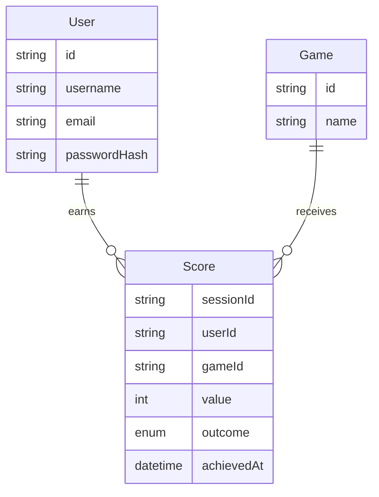

# Data model

The diagram below displays a high-level logical data model.  
This allows for a flow where: Users can login, select a game, and all their scores will be remembered.

outcome = win | lose | draw | tieforfeit

The boxes represent **entities**, with rows containing **attributes**, 
where first column is data type **descriptor**. The **relations** are expressed using lines, 
while **cardinality** is shown using [Crow's foot notation](https://en.wikipedia.org/wiki/Entity%E2%80%93relationship_model#Crow's_foot_notation).

> [!NOTE]
> This is a first iteration. Depending on product design decisions everything is subject to change.
