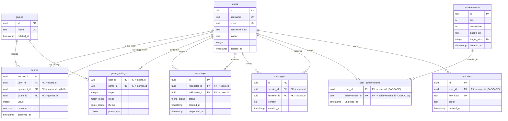

# Data Model

The diagram and specifications below describe the current database schema managed via Drizzle ORM and PostgreSQL.

## Entity-Relationship Diagram

---

## Enums

### `outcome`
Used in `scores.outcome` to represent the outcome of a game session for a player:
- `win`
- `lose`
- `draw`
- `forfeit`

### `friend_status`
Used in `friendships.status` to track friendship request state:
- `pending` (default)
- `accepted`
- `declined`

### `match_mode`
Used in `game_settings.mode`:
- `fixed-target-score` (default) — first to `target`; drawn rounds are replayed
- `fixed-rounds` — exactly `target` rounds; draws count; can end drawn

### `game_theme`
Used in `game_settings.theme`:
- `default` (default)
- `extra`

---

## Tables and Schema Details

### 1. `users`
Represents application user accounts. Supports soft deletion (`deleted_at`).

| Column | Type | Constraints & Defaults | Description |
| :--- | :--- | :--- | :--- |
| `id` | `uuid` | Primary Key, `defaultRandom()` | Unique user identifier |
| `username` | `text` | NOT NULL | Username (trimmed, length: 3–32 chars) |
| `email` | `text` | NOT NULL | Email address (max 254 chars, regex-validated format) |
| `password_hash` | `text` | NOT NULL | Bcrypt hash format check (`$2[aby]$...`) |
| `avatar` | `text` | NOT NULL, default `'/static/avatars/default.svg'` | Path or URL to avatar image |
| `xp` | `integer` | NOT NULL, default `0` | Experience points earned |
| `deleted_at` | `timestamp with time zone` | NULLABLE | Soft deletion timestamp |

**Indexes & Constraints:**
- **Index:** `users_leaderboard_idx` on `(xp DESC, username ASC)` WHERE `deleted_at IS NULL`
- **Unique Partial Index:** `users_username_active_unique` on `(username)` WHERE `deleted_at IS NULL`
- **Unique Partial Index:** `users_email_active_unique` on `(email)` WHERE `deleted_at IS NULL`
- **Check:** `users_username_length` (`username = trim(username) AND length(username) BETWEEN 3 AND 32`)
- **Check:** `users_email_format` (valid email regex pattern)
- **Check:** `users_email_max_length` (`length(email) <= 254`)
- **Check:** `users_password_hash_bcrypt` (valid bcrypt pattern)

---

### 2. `games`
Catalog of supported games. Supports soft deletion (`deleted_at`).

| Column | Type | Constraints & Defaults | Description |
| :--- | :--- | :--- | :--- |
| `id` | `uuid` | Primary Key, `defaultRandom()` | Unique game identifier |
| `name` | `text` | NOT NULL | Game name (trimmed, length: 1–64 chars) |
| `deleted_at` | `timestamp with time zone` | NULLABLE | Soft deletion timestamp |

**Indexes & Constraints:**
- **Unique Partial Index:** `games_name_active_unique` on `(name)` WHERE `deleted_at IS NULL`
- **Check:** `games_name_length` (`name = trim(name) AND length(name) BETWEEN 1 AND 64`)

---

### 3. `game_settings`
Per-user settings for each game. A user can have one settings row per game.

| Column | Type | Constraints & Defaults | Description |
| :--- | :--- | :--- | :--- |
| `user_id` | `uuid` | NOT NULL, Composite PK, FK -> `users(id)` | User these settings belong to |
| `game_id` | `uuid` | NOT NULL, Composite PK, FK -> `games(id)` | Game these settings apply to |
| `target` | `integer` | NOT NULL | Score to reach (`fixed-target-score`) or rounds to play (`fixed-rounds`), 1–10 |
| `mode` | `match_mode` | NOT NULL, default `'fixed-target-score'` | Match format (`fixed-target-score` or `fixed-rounds`) |
| `theme` | `game_theme` | NOT NULL, default `'default'` | How the game page looks; ignored by matchmaking |
| `power_ups` | `boolean` | NOT NULL, default `false` | One shield and one double per player per match; only players with the same choice are paired |

**Indexes & Constraints:**
- **Composite Primary Key:** `(user_id, game_id)`
- **Check:** `game_settings_target_allowed` (`target IN (1, 2, 3, 4, 5, 6, 7, 8, 9, 10)`)

---

### 4. `scores`
Per-player score and outcome record for a game session. Composite primary key on `(session_id, user_id)`.

| Column | Type | Constraints & Defaults | Description |
| :--- | :--- | :--- | :--- |
| `session_id` | `uuid` | NOT NULL, Composite PK | Shared session identifier for a game match |
| `user_id` | `uuid` | NOT NULL, Composite PK, FK -> `users(id)` | The player recording the score |
| `opponent_id` | `uuid` | NULLABLE, FK -> `users(id)` | Opponent player (if applicable) |
| `game_id` | `uuid` | NOT NULL, FK -> `games(id)` | The game played |
| `value` | `integer` | NULLABLE | Score points achieved (must be >= 0 if provided) |
| `outcome` | `outcome` | NOT NULL | Outcome for this user (`win`, `lose`, `draw`, `forfeit`) |
| `achieved_at` | `timestamp with time zone` | NOT NULL, default `now()` | Timestamp when the score was recorded |

**Indexes & Constraints:**
- **Composite Primary Key:** `(session_id, user_id)`
- **Index:** `scores_user_outcome_index` on `(user_id, outcome)`
- **Partial Index:** `scores_pvp_wins_by_user_idx` on `(user_id)` WHERE `outcome = 'win' AND opponent_id IS NOT NULL`
- **Check:** `scores_value_non_negative` (`value IS NULL OR value >= 0`)
- **Check:** `scores_opponent_not_self` (`opponent_id IS NULL OR opponent_id <> user_id`)

---

### 5. `friendships`
Friend requests and friendship statuses between pairs of users.

| Column | Type | Constraints & Defaults | Description |
| :--- | :--- | :--- | :--- |
| `id` | `uuid` | Primary Key, `defaultRandom()` | Unique friendship identifier |
| `requester_id` | `uuid` | NOT NULL, FK -> `users(id)` | User who initiated the friend request |
| `addressee_id` | `uuid` | NOT NULL, FK -> `users(id)` | Target user of the friend request |
| `status` | `friend_status` | NOT NULL, default `'pending'` | Request state (`pending`, `accepted`, `declined`) |
| `created_at` | `timestamp with time zone` | NOT NULL, default `now()` | Timestamp when request was sent |
| `responded_at` | `timestamp with time zone` | NULLABLE | Timestamp when request was accepted/declined |

**Indexes & Constraints:**
- **Unique Pair Index:** `friendships_pair_unique` on `(LEAST(requester_id, addressee_id), GREATEST(requester_id, addressee_id))` to prevent duplicate friendship links regardless of direction
- **Index:** `friendships_requester_status_idx` on `(requester_id, status)`
- **Index:** `friendships_addressee_status_idx` on `(addressee_id, status)`
- **Check:** `friendships_no_self_friend` (`requester_id <> addressee_id`)

---

### 6. `messages`
Direct chat messages sent between users.

| Column | Type | Constraints & Defaults | Description |
| :--- | :--- | :--- | :--- |
| `id` | `uuid` | Primary Key, `defaultRandom()` | Unique message identifier |
| `sender_id` | `uuid` | NOT NULL, FK -> `users(id)` | User who sent the message |
| `receiver_id` | `uuid` | NOT NULL, FK -> `users(id)` | User who receives the message |
| `content` | `text` | NOT NULL | Message body (length: 1–2000 chars) |
| `created_at` | `timestamp with time zone` | NOT NULL, default `now()` | Timestamp when message was created |

**Indexes & Constraints:**
- **Index:** `messages_sender_receiver_idx` on `(sender_id, receiver_id, created_at)`
- **Index:** `messages_receiver_sender_idx` on `(receiver_id, sender_id, created_at)`
- **Check:** `messages_no_self_message` (`sender_id <> receiver_id`)
- **Check:** `messages_content_length` (`length(content) >= 1 AND length(content) <= 2000`)

---

### 7. `achievements`
Catalog of unlockable game achievements and milestones.

| Column | Type | Constraints & Defaults | Description |
| :--- | :--- | :--- | :--- |
| `id` | `text` | Primary Key | Achievement identifier (e.g., `'WIN_1'`, `'WIN_5'`) |
| `title` | `text` | NOT NULL | Display title of the achievement |
| `description` | `text` | NOT NULL | Detailed achievement description / requirement |
| `badge_url` | `text` | NOT NULL | Asset URL or path to the badge icon |
| `target_wins` | `integer` | NOT NULL | Number of wins required to unlock |
| `created_at` | `timestamp with time zone` | NOT NULL, default `now()` | Timestamp when achievement was created |

**Indexes & Constraints:**
- **Unique Index:** `achievements_target_wins_unique` on `(target_wins)`
- **Check:** `achievements_target_wins_positive` (`target_wins > 0`)

---

### 8. `user_achievements`
Junction table tracking which achievements each user has unlocked.

| Column | Type | Constraints & Defaults | Description |
| :--- | :--- | :--- | :--- |
| `user_id` | `uuid` | NOT NULL, Composite PK, FK -> `users(id)` ON DELETE CASCADE | User who unlocked the achievement |
| `achievement_id` | `text` | NOT NULL, Composite PK, FK -> `achievements(id)` ON DELETE CASCADE | Unlocked achievement ID |
| `unlocked_at` | `timestamp with time zone` | NOT NULL, default `now()` | Timestamp when achievement was earned |

**Indexes & Constraints:**
- **Composite Primary Key:** `(user_id, achievement_id)`
- **Index:** `user_achievements_user_id_idx` on `(user_id)`

---

### 9. `api_keys`
API keys that let a user call the public API routes as themselves. Only a hash is stored; the key itself is shown once, at creation.

| Column | Type | Constraints & Defaults | Description |
| :--- | :--- | :--- | :--- |
| `id` | `uuid` | Primary Key, `defaultRandom()` | Unique key identifier |
| `user_id` | `uuid` | NOT NULL, FK -> `users(id)` ON DELETE CASCADE | The user the key acts as |
| `key_hash` | `text` | NOT NULL | SHA-256 of the key, in hex |
| `prefix` | `text` | NOT NULL | First characters of the key, to tell keys apart in the list |
| `created_at` | `timestamp with time zone` | NOT NULL, default `now()` | When the key was created |

**Indexes & Constraints:**
- **Unique Index:** `api_keys_key_hash_unique` on `(key_hash)`
- **Index:** `api_keys_user_id_idx` on `(user_id)`
